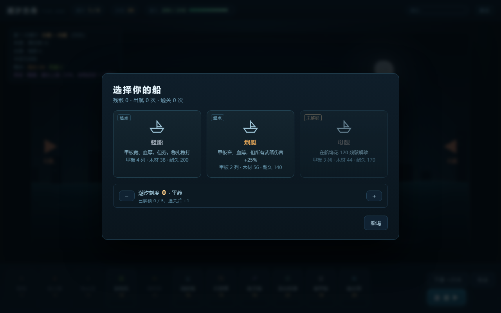
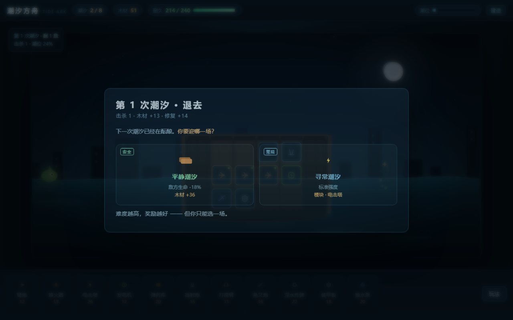
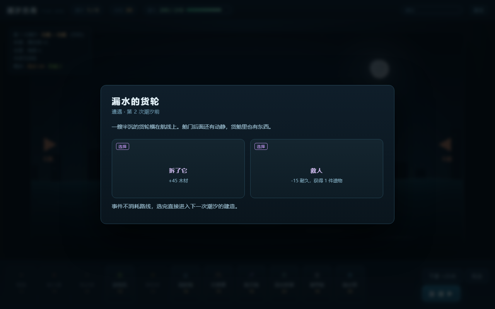
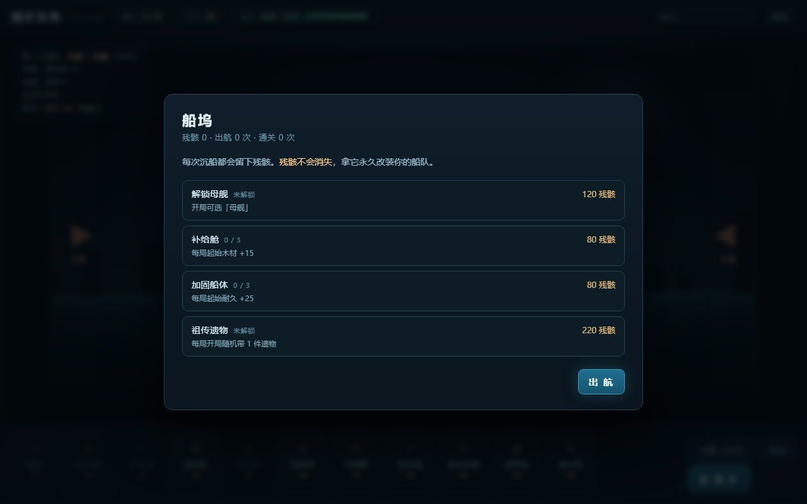
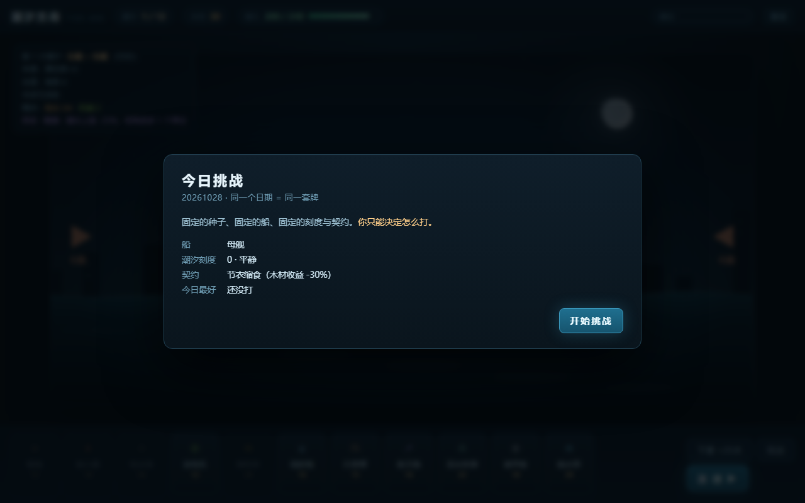
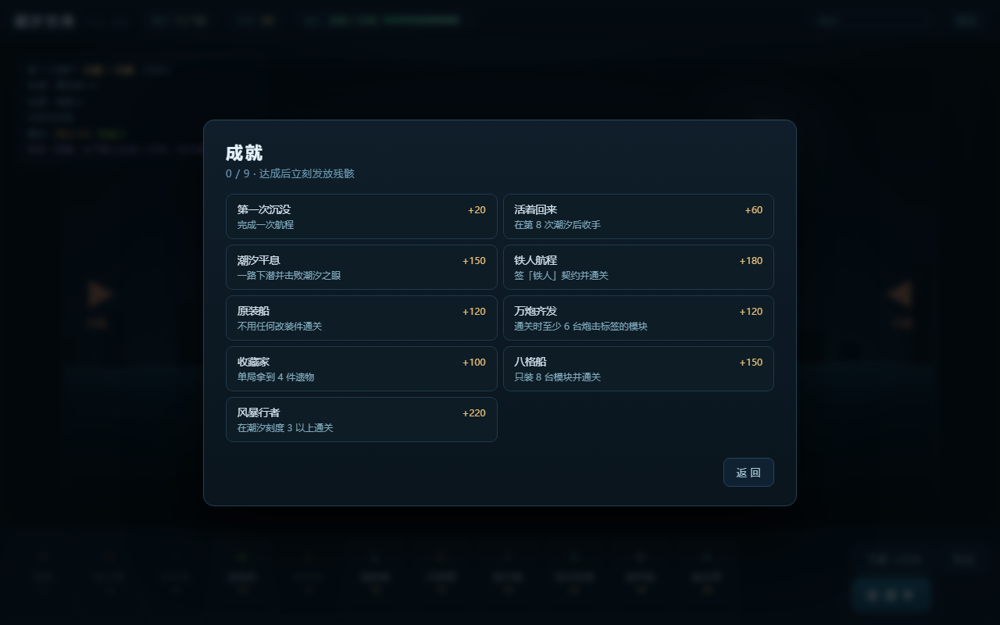
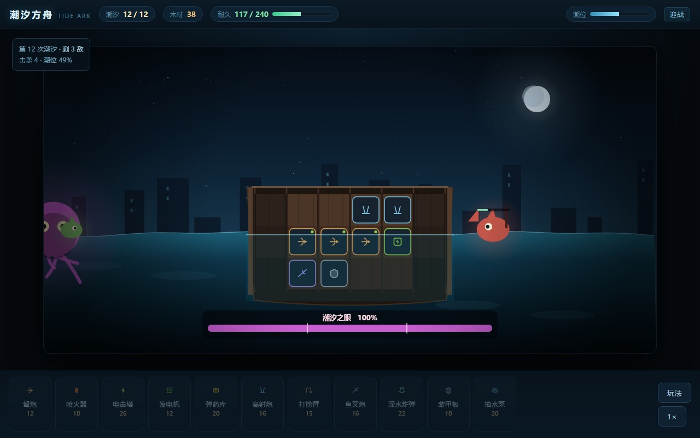

# 潮汐方舟 · Tide Ark

> 横板 · 配置构筑 · 自动战斗 · 单文件离线可玩

一个「把广告里的画面做成真正玩法」的小游戏 — **v0.11**


---

## 这是什么

你在一个被淹没的世界里，把一块破木筏一点点改造成战舰。

**退潮**时打捞、加固甲板、装模块；**涨潮**时海怪从左右两舷和水下扑上来，你装上的东西自动开火。
每撑过一次潮汐，你都要为下一场选一条路——更凶的敌人，换更好的东西。

没有操作，只有配置与取舍。死了也留下残骸，下一局从更强的起点再来。

---

## 直接玩

| 方式 | 文件 | 说明 |
|---|---|---|
| **推荐** | `standalone.html` | 单个 HTML，约 155 KB，双击即玩，断网可用 |
| 开发 | `index.html` | 拆分版（`style.css` + `data.js` + `core.js` + `app.js`） |

```bash
node tools/build-standalone.js   # 重新生成单文件版
```

---

## 一局的流程

```
第一幕  选船 → 建造 ⇄ 迎战 → 路线（战斗/事件）→ … → 第 8 次潮汐（潮汐巨兽）
                                                              ↓
                                                   收手（结算）或 下潜
                                                              ↓
第二幕  第 9–11 次潮汐（电鳗 / 幽影 / 深渊钳虫）→ 第 12 次：潮汐之眼
                                                              ↓
                                                    沉没 → 残骸 → 船坞改装 → 再来
```

### 1. 选船：起点决定打法



| 船 | 甲板 | 木材 | 耐久 | 特点 |
|---|---|---|---|---|
| **驳船** | 4 列 | 38 | 200 | 宽、厚，但穷 |
| **炮艇** | 2 列 | 56 | 140 | 窄、薄，所有武器伤害 +25% |
| **母舰** | 3 列 | 44 | 170 | 开局白送 2 个随机模块（需残骸解锁） |

### 2. 路线：明牌的取舍



每撑过一次潮汐，从 2–3 条路里挑一条。**难度是明牌，奖励也是明牌，但你只能选一场。**

| 类型 | 难度 | 奖励 |
|---|---|---|
| 平静潮汐 | 敌方生命 -18% | 木材 / 修复 |
| 寻常潮汐 | 标准 | 一个模块 |
| 强袭 | 生命 +20%，多 1 个单位 | 一个全局改造 |
| 精英潮 | 生命 +38%，多 2 个单位 | **一个遗物** |
| 遭遇 | 未知 | 由你自己的选择决定 |

### 3. 事件：故事也是资源



一半的路线会撞上一次遭遇。每个选择都有代价：

> 漏水的货轮：**拆了它**（+45 木材）／**救人**（-15 耐久，+1 遗物）
> 幽灵船：**登船**（55% 拿遗物，45% 掉 25 耐久）／**绕开**（+15 木材）
> 油污海域：**点火**（下一波敌人 -25% 生命，但多 1 个单位）／**绕开**

### 4. 羁绊：构筑的认同

模块带标签，同标签凑够数量触发质变（左上角实时显示进度）：

| 羁绊 | 2 件 | 4 件 |
|---|---|---|
| **炮击**（弩炮/高射炮/鱼叉炮/迫击炮/撞角） | 所有武器伤害 +8% | 伤害 +20%，射程 +1 列 |
| **燃烧**（喷火器/深水炸弹/电击塔/火箭巢/照明弹/水雷） | 范围伤害半径 +30% | 击杀时炸开，对周围造成 18 伤害 |
| **机械**（发电机/弹药库/装甲板/抽水泵/打捞臂/信号灯/维修台/电磁幕/声呐） | 发电机加成 20% → 40% | 每波 +20 木材，加固费用 -25% |

「这局我走炮击还是燃烧」——是每局最先要回答的问题。

### 5. 残骸：死了也不归零



沉船按进度给残骸（波次 ×12 + 击杀 ×0.6，通关额外 +80，**契约与刻度再乘倍率**）。残骸永久保留：

| 改装 | 花费 | 效果 |
|---|---|---|
| 解锁母舰 | 120 | 开局可选第三种船 |
| 补给舱 ×3 | 80 | 每局起始木材 +15 |
| 加固船体 ×3 | 80 | 每局起始耐久 +25 |
| 祖传遗物 | 220 | 每局开局带 1 件随机遗物 |
| 备用改装件 ×3 | 120 | 每局开局带 1 个随机改装件 |
| 预制组件 ×2 | 150 | 每局开局多 1 个随机模块 |
| 压舱货舱 ×10 | 60 起，价格 ×1.35 递增 | 每局起始木材 +2（长期消耗，不会买完） |

买完前六项大约要 1160 残骸（十几局），压舱货舱则是永久的余钱去处。

### 6. 异变：每局一条全局规则

开局抽一条，整局生效，**好坏都有**，左上角一直显示：

| 异变 | 效果 |
|---|---|
| 逆潮 | 潮水上涨 +20%，但每波结束 +25 木材 |
| 丰饶 | 木材收益 +35%，敌方生命 +18% |
| 静水 | 敌方移速 -15%，但你的射程 -10% |
| 血月 | 敌方啃咬 +30%，但每波修复 +25 |
| 钢铁 | 敌方生命 +28%，但加固费用 -30% |
| 深潜 | 水下敌人生命 +50%，你对潜伤害 +50% |
| 浓雾 | 所有射程 -20%，敌方生命 -15% |
| 蜂群 / 慢潮 / 废土 | 数量换质量、潮速换数量、起始换每波 |

「这局是丰饶，可以放心买贵的」——每局的第一判断就变了。

### 7. 潮汐刻度：通关之后才开始

通关一次解锁下一级，最高 5 级。**敌人更强，但残骸倍率也更高**（每级 +30%）：

| 刻度 | 追加 |
|---|---|
| 1 涟漪 | 敌方生命 +8% |
| 2 涌浪 | +16% |
| 3 暗涌 | +24%，每波多 1 个单位，起始木材 -10 |
| 4 风暴 | +32%，敌方移速 +10% |
| 5 大潮 | +40%，潮水上涨 +15% |

这是重复游玩的真正入口：**同一套构筑，在刻度 4 上活不过第 5 波。**

### 8. 契约：自己给自己加难度

出航前可以签一张契约（每次随机给 3 张），**换残骸倍率**：

| 契约 | 代价 | 倍率 |
|---|---|---|
| 铁人 | 本局不能加固甲板 | ×1.55 |
| 贫穷 | 起始木材 -25 | ×1.3 |
| 蜂拥 | 每波多 2 个单位 | ×1.35 |
| 高压 | 敌人生命 +35% | ×1.4 |
| 疾行 | 敌人移速 +25% | ×1.35 |
| 逆潮 | 潮水上涨 +30% | ×1.3 |
| 残破 | 起始耐久 -40 | ×1.3 |
| 节衣缩食 | 木材收益 -30% | ×1.5 |

契约和刻度是两套乘法：刻度是「你已经通关了，来点更狠的」，契约是「这一局我想怎么玩」。
签了「铁人」，整局的扩建决策直接消失，玩法从「宽甲板铺满」变成「六格以内的精算」。

### 9. 每日挑战 + 成就



选船页多了两个入口：

- **今日挑战** —— 日期当种子（`20261028`），船 / 刻度 / 契约全部固定，全世界同一套牌，
  你只能决定怎么打。每天记录最好成绩。
- **成就** —— 9 个长期目标，达成立刻发残骸。有些是在逼你换玩法：



| 成就 | 条件 | 残骸 |
|---|---|---|
| 第一次沉没 | 完成一次航程 | +20 |
| 活着回来 | 第 8 波后收手 | +60 |
| 潮汐平息 | 下潜并击败潮汐之眼 | +150 |
| 铁人航程 | 签「铁人」契约通关 | +180 |
| 原装船 | 不用任何改装件通关 | +120 |
| 万炮齐发 | 通关时 ≥6 台炮击标签 | +120 |
| 收藏家 | 单局拿到 4 件遗物 | +100 |
| 八格船 | 只装 8 台模块通关 | +150 |
| 风暴行者 | 刻度 3 以上通关 | +220 |

「八格船」和「万炮齐发」是互斥的，想全拿就得换两套完全不同的构筑。

### 10. 模块改装：单台武器变形

改装件挂到**具体一台武器**上，一台只能挂一个。它们不加大数字，而是改这台炮的行为：

| 改装 | 效果 |
|---|---|
| 重弹 | 伤害 +45%，射速 -25% |
| 连射 | 射速 +40%，伤害 -25% |
| 溅射 | 命中时对 55px 内敌人造成 35% 伤害 |
| 穿透 | 额外命中同泳道后方 2 个目标 |
| 燃烧弹 | 命中附加 9/秒，持续 3 秒 |
| 冷凝 | 命中减速 35%，持续 2 秒 |
| 高角 | 可打相邻泳道，伤害 -30% |
| 回充 | 击杀后立刻重置冷却 |
| 扩音 | 相邻模块射速 +12% |
| 轨道 | 射程 +3 列，伤害 -20% |
| 追猎 | 优先攻击**最远**的目标 |
| 引信 | 爆炸半径 +60% |

同一套「炮击 6」的羁绊，给边角那门挂**穿透**还是**溅射**，清群和打单体的手感完全不同。
改装件从强袭路线（45%）和事件获得，进底部「改装件」条，选中后点一台武器挂上去；拆炮时改装件退回。

### 11. 模块 20 种：构筑空间的底子

第一版只有 11 个模块，构筑其实没有分叉。现在 20 个，按三层甲板排：

| 层 | 模块 |
|---|---|
| **高空** | 高射炮 / 火箭巢（高速连射）/ 照明弹（大范围）/ 信号灯（本层射程 +1）/ 打捞臂 |
| **主甲板** | 弩炮 / 喷火器 / 电击塔 / 迫击炮（7 列超远）/ 撞角（1 列贴脸 45 伤）/ 发电机 / 弹药库 / 维修台 / 电磁幕 |
| **水下舱** | 鱼叉炮 / 深水炸弹 / 水雷（6 秒一发 60 伤）/ 声呐（对潜射程 +2）/ 装甲板 / 抽水泵 |

几个刻意的「极端件」让流派真的分叉：

- **撞角**：射程只有 1 列，但 45 伤害。逼你把甲板堆在敌人必经的舷侧，和「远狙」完全相反
- **迫击炮**：7 列射程覆盖整条来路，但 2.6 秒一发 —— 只在敌人排成队时值钱
- **水雷**：6 秒一发，一发 60。适合「怪海里炸一次」，不适合持续压制
- **信号灯 / 声呐**：改变别的模块的射程，本身不输出

### 12. 第二幕：打完 Boss 还能再赌一把

第 8 次潮汐（潮汐巨兽）打完后，给你一个明确的选择：

- **收手** —— 结算这次航程，拿走残骸
- **下潜** —— 再打 4 次潮汐，最后是 1400 血的「潮汐之眼」，残骸翻倍

第二幕换了一批敌人，机制上都不是加血：

| 敌人 | 特点 |
|---|---|
| 电鳗 | 水下，极快（92），专咬船底 |
| 幽影 | 空中，最快（118），血量不高但拦不住就撞上来 |
| 深渊钳虫 | 海面，220 血，慢，咬得重 |

第二幕的加量曲线是刻意压平的（甲板已经到顶），所以难度来自**密度和速度**，不是数值堆叠。

### 13. 多阶段 Boss：血量阈值换招式



两个 Boss 都有多个阶段（画面上有带刻度的血条，刻度就是换招的节点）：

**潮汐巨兽**（第 8 波）

| 阶段 | 触发 | 变化 |
|---|---|---|
| 1 | 100% | 缓慢逼近，边啃边打 |
| 2 | 50% | 移速 ×1.45、啃咬 ×1.3，并召来 1 只漂流者 |

**潮汐之眼**（第 12 波）

| 阶段 | 触发 | 变化 |
|---|---|---|
| 1 | 100% | 海面缓慢逼近 |
| 2 | 70% | **潜入水下**，移速 ×1.9 —— 你的对海火力这时全部失效 |
| 3 | 35% | **浮回海面**并狂暴：移速 ×1.5、啃咬 ×1.5，召来 2 只潮蝠和 1 只电鳗 |

这就是「第二幕必须三条泳道都有覆盖」的原因：只堆对海火力，打到 70% 就只能看着它在水下啃船底。
第 12 波的预告里会明确提示「会在水面与水下之间切换」。

---

## 战斗规则

### 敌人不只有血条

| 敌人 | 行为 | 你的应对 |
|---|---|---|
| **铁壳蟹** | 护甲 4：每次受击先扣 4 | 小口径连射（火箭巢 9 伤剩 5）会被吃光，得靠重弹/迫击炮 |
| **孢囊** | 死亡时裂成 2 个碎片 | 单体点杀会越打越多，得范围清 |
| **狙击鳐** | 停在 160px 外射击，不贴脸 | 撞角这种 1 列射程的武器完全够不到 |
| **潮母** | 每 2 秒治疗周围 150px 内的敌人 | 不优先点掉，其它怪就是无限血 |

这四种是为了逼你**不能只堆一种武器**：高护甲怕重炮、分裂怕范围、远程怕长射程、治疗怕爆发。

### 三层甲板 = 三条泳道

- **高空甲板** 只能打**空中**（潮蝠）
- **主甲板** 只能打**海面**（漂流者、甲壳兽、掠夺艇）
- **水下舱** 只能打**水下**（深潜者）

### 左右舷：射程按「列」算

武器**打不到对侧**。靠左的炮覆盖左舷，靠右的覆盖右舷。
没加固外侧列，就够不着远处的敌人——「往哪边扩」是一次真实的空间决策。

### 甲板就是资源

开局只有中间几列，两侧是断的，要花木材**加固**（内侧 30 / 外侧 50，每列 +3 格 + 耐久）。

### 潮汐词条

第 4 波起，约 60% 的潮汐会带一个词条（共 10 种）：逆流（移速 +35%）· 浓雾（射程 -20%）·
铁潮（生命 +30%）· 蜂群（+3 个单位但血 -25%）· 血月（啃咬 +50%）· 暗流（多 2 只深潜者）·
磁暴（射速 -12%）· 空袭（多 2 只潮蝠）· 铁幕（所有敌人护甲 +3）· 春潮（潮水快 40%）。

### 满潮

潮水涨满还没清场 → 敌人**狂暴** + 船舱**持续进水**，基本必死。
主甲板在潮位过高时也会进水、射速下降。

---

## 设计笔记

起点是《疯狂水世界》的广告：广告里是海上求生、捞海水过滤器、住进高级庇护所，
实际进游戏是纯数值卡牌挂机。广告和游戏是两条平行线。

于是反过来做：**把那支 15 秒广告里的每个画面，都做成真实的系统。**

| 广告里的瞬间 | 在这里是什么 |
|---|---|
| 从水里捞起过滤器 | 每波结束的打捞 |
| 住进高级庇护所 | 木筏一列列被你自己加固出来 |
| 水位上涨、怪物围上来 | 潮汐就是波次计时器，也会真的淹没甲板 |
| 潜下去看深海 | 「下潜」换资源，但要拿这一波的安全去赌 |
| 「启动！」 | 撑过第 8 次潮汐 |

**参考游戏**：Loop Hero（无操作构筑循环）、剑与远征（横板自动战斗表现层）、
Slay the Spire（路线 + 明牌取舍）、FTL（局外解锁 + 每次重开都不同）。

### 版本演进

- **v0.1** 波次写死、甲板一开始满格 —— 每局一模一样
- **v0.2** 随机波次 + 词条 + 甲板从 6 格起步 + 全局改造 —— 有变数，但仍是一种玩法
- **v0.3** 选船 + 路线 + 遗物 —— 起点、路径、收获都不同
- **v0.3.1** 修画面冻结 / 敌人朝向 / 波次计数
- **v0.4** 羁绊 + 事件 + 局外成长 —— 构筑有流派，路线有故事，失败有积累
- **v0.5** 每局异变 + 潮汐刻度（0–5 级）—— 每局规则不同，通关之后还有下一档
- **v0.6** 模块改装 + 第二幕 —— 单台武器可以变形；8 波之后还能再赌一段
- **v0.7** 多阶段 Boss —— 两个 Boss 都会在血量阈值处换招式，不再只是血包
- **v0.8** 契约 + 船坞扩容 —— 自己加难度换倍率，残骸终于有了长期去处
- **v0.9** 每日挑战 + 成就 —— 每天有一局新的，长期有 9 个目标
- **v0.10** 内容扩容 —— 模块 11 → 20，改装件 9 → 12，构筑空间翻倍
- **v0.11** 敌人行为 —— 护甲 / 分裂 / 远程 / 治疗，词条 6 → 10

---

## 技术架构

三层，**逻辑层零渲染依赖**：

```
data.js   纯数值表：模块 / 敌人 / 词条 / 改造 / 遗物 / 船 / 事件 / 路线生成器
core.js   纯逻辑：扩建、建造、潮汐战斗模拟（确定性，不碰 DOM）
app.js    渲染与交互：Canvas 场景 + DOM 面板 + localStorage 存档
```

- **可以 headless 跑**：`tools/balance.js` 用贪心 AI 打几百局，1 秒出胜率曲线
- **可复现**：同一 seed + 同一串选择 = 同一局
- 画布固定 1120×560，全部矢量绘制，**没有任何图片/音频资源**

---

## 数值回归

```bash
node tools/balance.js 400          # 批量跑
node tools/balance.js 1 --trace    # 单局详细战况
```

难度是递增的，同一套贪心 AI：

| 目标 | 通过率 |
|---|---|
| 刻度 0 · 活过第一幕（可在第 8 波收手） | ~55% |
| 刻度 0 · 一路下潜到潮汐之眼 | ~27% |
| 刻度 2 · 一路下潜 | ~17% |
| 刻度 4 · 一路下潜 | ~2% |

死亡分布：第 5 波（深潜者登场）20%、第 7 波 14%、第 10–12 波合计 25%。
注意 AI 不会用改装件，所以真人成绩通常比这组数字好一些。

调平衡只改 `data.js`，不要动 `core.js`。

---

## 目录

```
index.html            拆分版入口
standalone.html       单文件离线版
style.css
data.js               模块 / 敌人 / 词条 / 改造 / 遗物 / 船 / 事件 / 路线
core.js               扩建 + 建造 + 战斗逻辑（纯函数，可 headless）
app.js                Canvas 渲染 + DOM 交互 + 存档 + 流程
tools/balance.js      数值回归
tools/build-standalone.js
docs/                 截图
```

### 调试参数

```
index.html?nointro=1                 跳过开场
        &demo=1                       预置甲板
        &select=1                     选船页
        &dock=1                       船坞
        &event=1                      事件弹窗
        &battle=1&sim=12              开战并快进
        &wave=5                       指定波次
        &reward=1                     路线弹窗
```

---

## Roadmap

- [ ] **内容解锁池**：现在所有模块/遗物/改装件从第一局就在池子里，缺少「发现」；
  可以做成前几局只开放一部分，其余用残骸或通关解锁
- [ ] 战斗日志面板与伤害分解
- [ ] 音效（WebAudio 合成，不引入资源文件）
- [ ] 移动端触控布局

---

## License

MIT
