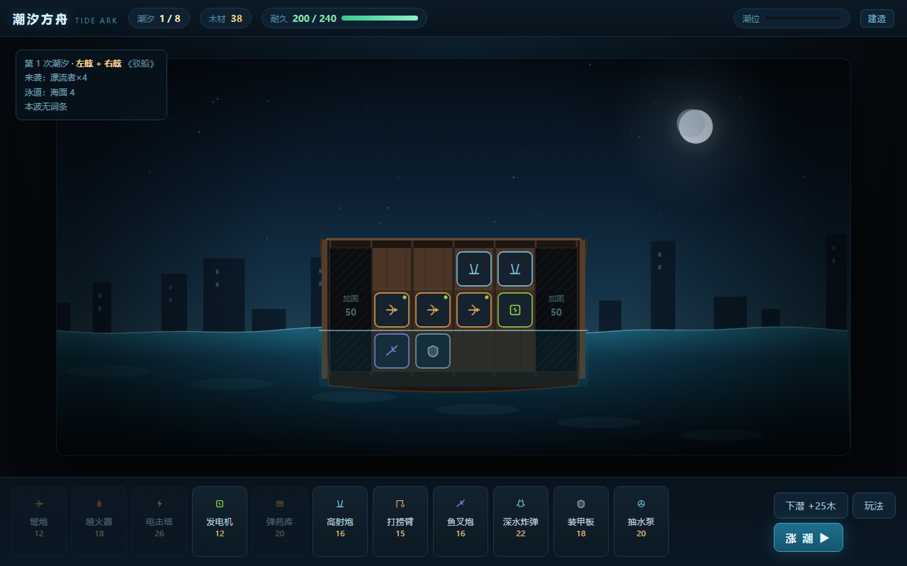
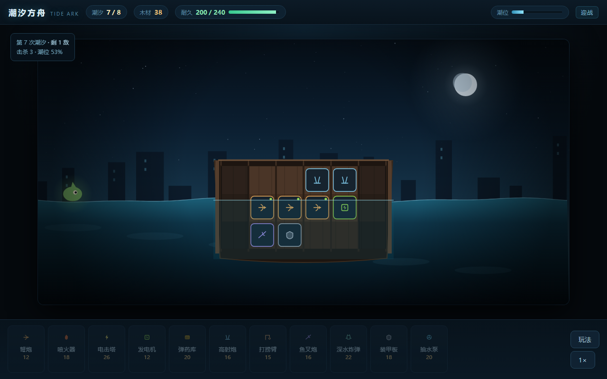

# 潮汐方舟 · Tide Ark

> 横板 · 配置构筑 · 自动战斗 · 单文件离线可玩

一个「把广告里的画面做成真正玩法」的小游戏 — **v0.2**




---

## 这是什么

你在一个被淹没的世界里，把一块破木筏一点点改造成战舰。

**退潮**时打捞、加固甲板、装模块；**涨潮**时海怪从左右两舷和水下扑上来，你装上的东西自动开火。
撑过 8 次潮汐。

没有操作，只有配置。乐趣在于：**你摆的每一格，决定了这一波能不能守住。**

---

## 直接玩

两种方式，都不需要构建、不需要 npm、不需要联网：

| 方式 | 文件 | 说明 |
|---|---|---|
| **推荐** | `standalone.html` | 单个 HTML，约 84 KB，双击即玩，断网可用 |
| 开发 | `index.html` | 拆分版（`style.css` + `data.js` + `core.js` + `app.js`），改完刷新即可 |

重新生成单文件版：

```bash
node tools/build-standalone.js
```

---

## 玩法

| 阶段 | 你做什么 |
|---|---|
| **建造** | 花木材加固甲板、装模块，点「涨潮」开战 |
| **迎战** | 所有模块自动开火，可 1/2/4 倍速，也可「瞬间结算」 |
| **打捞** | 三选一：新模块 / 全局改造 / 木材或修复 |

### 甲板就是资源

一开始你只有**中间两列**甲板（3×2 = 6 格）。
两侧的列是断的，要花木材**加固**：

| 列 | 价格 | 代价 |
|---|---|---|
| 第 2 / 5 列（内） | 30 木材 | 3 个格子 + 20 耐久 |
| 第 1 / 6 列（外） | 50 木材 | 3 个格子 + 30 耐久 |

**这决定了整局的核心取舍**：钱花在「更多炮」还是「更宽的甲板」。
而且外挂列不只是格子——它决定你能不能**够到远处的敌人**。

### 三层甲板 = 三条泳道

- **高空甲板** 只能打**空中**（潮蝠）
- **主甲板** 只能打**海面**（漂流者、甲壳兽、掠夺艇）
- **水下舱** 只能打**水下**（深潜者）

### 左右舷：射程按「列」算

武器**打不到对侧**。靠左的炮覆盖左舷，靠右的覆盖右舷。
中间两列能两边都顾一点，但覆盖都很浅——所以敌人从哪边来，直接决定你该往哪边扩。

每波来袭方向会提前标在画面上（← 左舷 / 右舷 →）。

### 潮汐词条：每波可能换一种难题

第 4 波起，约 60% 的潮汐会带一个词条：

| 词条 | 效果 |
|---|---|
| 逆流 | 敌方移动速度 +35% |
| 浓雾 | 所有武器射程 -20% |
| 铁潮 | 敌方生命 +30% |
| 蜂群 | 敌方数量 +3，生命 -25% |
| 血月 | 敌方啃咬伤害 +50% |
| 暗流 | 额外 2 只深潜者 |

词条会写在左上角预告里。**同一套甲板撑不过所有词条**，所以你得留后手。

### 潮汐本身

- 潮水涨满还没清场 → 敌人**狂暴**、船舱**持续进水**，基本必死
- 主甲板在潮位过高时**进水**，射速变慢
- **抽水泵** 能拖慢涨潮，给你更多清理时间

### 其他

- **发电机**：可放任意层，让这一层武器射速 +20%
- **弹药库**：相邻武器伤害 +25%（最多 +50%）
- **下潜**：换 25 木材，但这一波会多来 2 只深潜者
- 失败后会告诉你：这局主要是被哪条泳道打穿的

---

## 设计笔记

起点是《疯狂水世界》的广告：广告里是海上求生、捞海水过滤器、住进高级庇护所，
实际进游戏是纯数值卡牌挂机。广告和游戏是两条平行线。

于是反过来做：**把那支 15 秒广告里的每个画面，都做成真实的系统。**

| 广告里的瞬间 | 在这里是什么 |
|---|---|
| 从水里捞起过滤器 | 每波结束的三选一打捞 |
| 住进高级庇护所 | 木筏一列列被你自己加固出来 |
| 水位上涨、怪物围上来 | 潮汐就是波次计时器，也会真的淹没甲板 |
| 潜下去看深海 | 「下潜」换资源，但要拿这一波的安全去赌 |
| 「启动！」 | 撑过第 8 次潮汐 |

**参考游戏**：Loop Hero（无操作构筑循环）、剑与远征（横板自动战斗的表现层）、
Slay the Spire（三选一 + 逐波加压）、Kingdom（横板发展自动化）。

### v0.2 改了什么

v0.1 的问题很直接：**波次是写死的 8 条，每局一模一样**，玩第二遍就没有决策了；
而且甲板一开始就给了 18 格，钱永远够用，后半程没有任何取舍。

v0.2 动了三件事：

1. **每局都不一样** —— 波次由预算随机生成（敌人池随波次解锁），词条再叠一层变数
2. **空间变稀缺** —— 甲板从 6 格起步，扩建要花钱，外挂列决定射程覆盖
3. **构筑有成长** —— 加入 9 种全局改造（射程/穿甲/装填/对空/对潜…），
   和模块一起抢你的选择位

---

## 技术架构

刻意做成三层，**逻辑层零渲染依赖**：

```
data.js   纯数值表：模块 / 敌人 / 词条 / 改造 / 波次生成器
core.js   纯逻辑：扩建校验、建造、潮汐战斗模拟（确定性，不碰 DOM）
app.js    渲染与交互：Canvas 场景 + DOM 面板
```

好处：

- **可以 headless 跑**：`tools/balance.js` 用贪心 AI 打几百局，1 秒出胜率曲线
- **可以倍速/瞬间结算**：渲染只是订阅 `step()` 产出的状态和事件
- **可以整局回放**：状态可序列化（种子 + 决策即可复现，后续接 IndexedDB 存档）

画布固定 1120×560，全部矢量绘制，**没有任何图片/音频资源**，所以单文件只有 84 KB。

---

## 数值回归

```bash
node tools/balance.js 400          # 批量跑 400 局
node tools/balance.js 1 --trace    # 跑 1 局，打印最终甲板 / 词条 / 逐秒战况
```

当前调校（600 局，贪心 AI）：**通关率约 66%**，
死亡分布在第 5–8 波（第 5 波「深潜者首次登场」和第 8 波 Boss 是两道坎）。

AI 大致相当于「懂规则但不会精算」的玩家，所以真人玩起来会更接近 50–60%。

调平衡只改 `data.js`，不要动 `core.js`。

---

## 目录

```
index.html            拆分版入口
standalone.html       单文件离线版（由 tools/build-standalone.js 生成）
style.css
data.js               模块 / 敌人 / 词条 / 改造 / 波次生成
core.js               扩建 + 建造 + 战斗逻辑（纯函数，可 headless）
app.js                Canvas 渲染 + DOM 交互 + 流程
tools/balance.js      数值回归
tools/build-standalone.js
docs/                 截图
```

### 调试参数

```
index.html?nointro=1                 跳过开场说明
        &demo=1                       预置一套甲板
        &battle=1&sim=12              直接开战并快进 12 秒
        &wave=5                       从第 5 波开始
        &reward=1                     直接看打捞弹窗
```

---

## Roadmap

- [ ] **路线图**：把直线 8 波换成可选的节点（商店 / 事件 / 精英），出现「跳关换资源」的取舍
- [ ] **羁绊**：模块带标签，凑齐 3 个同标签触发质变（现在只有数值协同）
- [ ] 存档与局外解锁（IndexedDB + 残骸解锁新模块）
- [ ] 战斗日志面板与伤害分解
- [ ] 音效（WebAudio 合成，不引入资源文件）
- [ ] 移动端触控布局

---

## License

MIT
